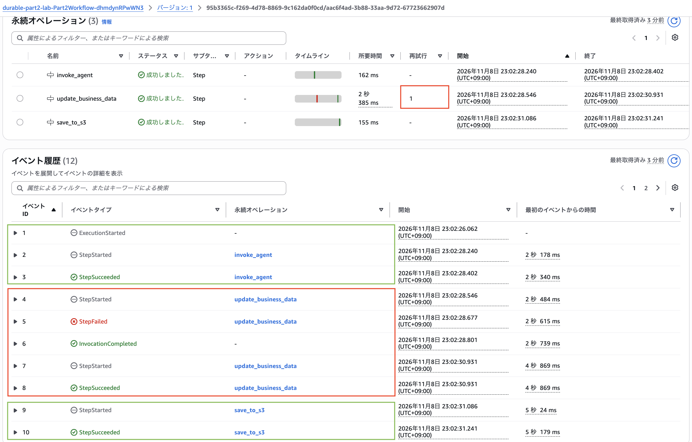
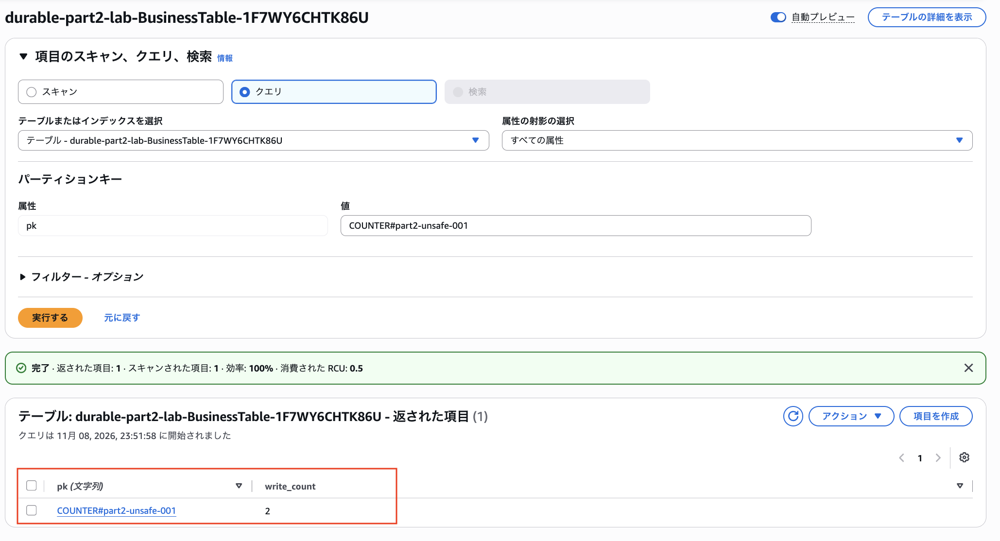
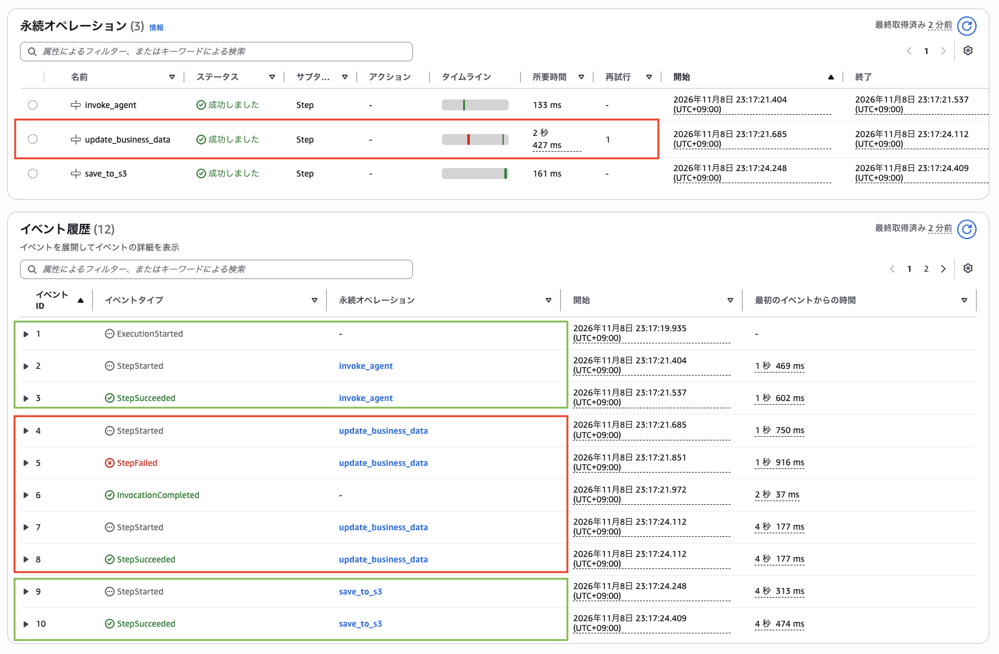
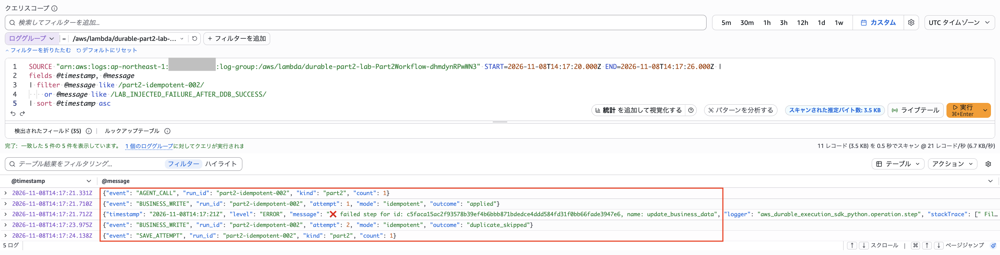
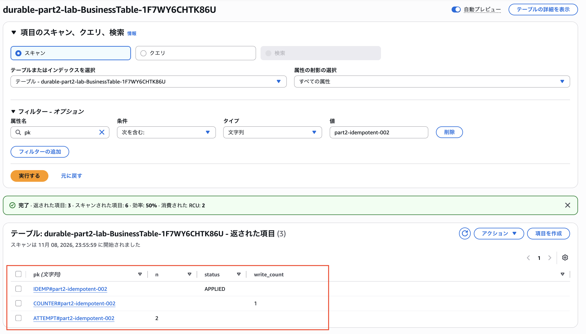

## はじめに

前回の記事では、Amazon Bedrock AgentCore RuntimeとAWS Lambda Durable Functionsを組み合わせ、Agentの処理が完了したあとにS3保存で失敗した場合の再実行動作を検証しました。
https://zenn.dev/takuyousou/articles/agentcore-lambda-durable-retry
その結果、Durable Functionsでは完了済みのStepの結果を再利用し、失敗したS3保存Stepだけを再試行できることを確認しました。

ただ、ここで一つ気になることがあります。

**Stepの処理が途中まで成功していた場合、再試行するとどうなるのでしょうか？**

たとえば、Stepの中で外部サービスへの更新が成功した直後にエラーが発生した場合です。

更新自体は完了していますが、Stepは正常終了していないため、再試行によって同じ更新が繰り返されるかもしれません。

そこで今回は、DynamoDBへの書き込みを例に、**更新成功後に意図的なエラーを発生させ、Stepの再試行によって二重更新が起きるのか**を検証してみました。

さらに、DynamoDB Transactionsと条件付き書き込みを使い、冪等性を考慮した実装で重複更新を防げるのかも確認します。

## 本記事の対象者

- Lambda Durable FunctionsのStepとCheckpointの動作を理解したい方
- リトライ時のDynamoDB更新の重複が気になっている方
- 冪等性を考慮した処理の実装方法を知りたい方

## 今回の検証構成

前回はAgent処理が成功したあと、S3保存Stepでエラーを発生させました。今回は失敗させる場所を変え、**DynamoDBの業務データ更新が成功した直後**にエラーを発生させます。

```text
Lambda Durable Functions
  │
  ├─ Step 1：invoke_agent
  │    └─ 分析結果を取得
  │
  ├─ Step 2：update_business_data
  │    ├─ DynamoDBの業務データを更新
  │    └─ 初回のみ意図的なエラー
  │
  └─ Step 3：save_to_s3
       └─ 結果をS3に保存
```

`invoke_agent`、`update_business_data`、`save_to_s3`を独立したStepにしています。今回の検証対象は2番目の`update_business_data`です。

| | Unsafe | Idempotent |
|---|---|---|
| DynamoDB更新 | 通常のUpdateItem | Transactionsと条件付き書き込み |
| 重複判定 | なし | 操作IDによる判定 |
| Stepの試行回数 | 最大2回 | 最大2回 |
| 確認したいこと | 更新が重複するか | 重複更新を防げるか |

両方とも同じDurable Functionsを使用し、業務更新の実装だけを切り替えます。

## Checkpointがあっても二重実行される理由

Durable Functionsでは、Stepが正常に完了すると、その結果がCheckpointに記録されます。後続のStepが失敗しても、完了済みStepの結果を再利用できる点は前回確認しました。

しかし、Step内で外部サービスを更新する場合は少し事情が異なります。

```text
update_business_data Step
  │
  ├─ DynamoDB更新成功
  ├─ 意図的なエラー発生
  └─ Step失敗
       └─ Step再試行
            └─ DynamoDB更新処理を再実行
```

DynamoDBへの更新成功と、Durable Stepの正常終了は別の出来事です。

**外部サービスへの更新が成功していても、Stepが失敗すれば、再試行によって同じ処理が再び実行される可能性があります。**

Checkpointは完了済みStepの再実行を避けるための仕組みですが、Step内の外部処理を自動的にExactly-onceにするものではありません。

## 検証環境

| 項目 | 内容 |
|---|---|
| Region | 東京（ap-northeast-1） |
| 構築 | AWS SAM |
| Lambda | Python 3.14、Durable Functions |
| 業務データ | Amazon DynamoDB |
| 結果保存 | Amazon S3 |
| 実行記録 | CloudWatch Logs、Durable Execution History |
| 失敗条件 | 初回のDynamoDB更新成功後に例外を発生 |
| Retry | 最大2回、2秒の固定間隔 |

前回の検証環境とは別に、今回の業務更新用DynamoDBテーブルとDurable Lambdaを用意しました。DynamoDBには業務更新とは別にStep内の試行回数も記録し、**試行回数と実際に反映された更新回数**を比較します。

## 今回の実装ポイント

Retry設定は共通にして、DynamoDBの更新方法だけを切り替えています。ここでは主要部分のみ紹介します。

### Stepの再試行設定

```python
business = context.step(
    update_business_step(run_id, mode),
    name='update_business_data',
    config=retry_twice,
)
```

`retry_twice`は最大2回試行、2秒の固定間隔です。`update_business_data`が失敗すると再試行されますが、すでに成功した`invoke_agent` Stepは保存済みの結果を再利用します。

### Unsafe：通常のUpdateItemで更新する

```python
client.update_item(
    TableName=TABLE,
    Key=counter_key,
    UpdateExpression='ADD #n :one',
    ExpressionAttributeNames={'#n': 'write_count'},
    ExpressionAttributeValues={':one': {'N': '1'}},
)
```

DynamoDBの`ADD`で`write_count`を1増やします。重複判定がないため、同じ操作が2回実行されると`write_count`も2になります。

### Idempotent：DynamoDB Transactionsで重複更新を防ぐ

`operation_id`で業務操作を識別し、**冪等性マーカーの作成と業務データの更新を一つのTransactionにまとめます。**

```python
client.transact_write_items(
    TransactItems=[
        {
            'Put': {
                'TableName': TABLE,
                'Item': {
                    'pk': {'S': f'IDEMP#{operation_id}'},
                    'status': {'S': 'APPLIED'},
                },
                'ConditionExpression': 'attribute_not_exists(pk)',
            }
        },
        {
            'Update': {
                'TableName': TABLE,
                'Key': counter_key,
                'UpdateExpression': 'ADD #n :one',
                'ExpressionAttributeNames': {'#n': 'write_count'},
                'ExpressionAttributeValues': {':one': {'N': '1'}},
            }
        },
    ]
)
```

同じ操作IDのマーカーがすでに存在すると、条件付きPutが成立せずTransactionはキャンセルされます。実験コードではその後マーカーを確認し、存在する場合は`duplicate_skipped`として扱います。

マーカー作成と業務更新を原子的に実行できるため、マーカーだけが残って業務更新が反映されない、といった状態を防げます。

なお、今回の重複判定は実験用の簡易実装です。実運用ではTransactionのキャンセル理由や、既存マーカーが同一の業務内容を表しているかまで確認する必要があります。

### 更新成功後にエラーを発生させる

両モードで業務更新処理のあとに次のコードを実行します。

```python
if inject_failure and attempt == 1:
    raise RuntimeError(
        'LAB_INJECTED_FAILURE_AFTER_DDB_SUCCESS'
    )
```

`attempt`はDynamoDBに記録した試行回数です。初回のみ例外を発生させ、2回目は通常どおり続行します。

ここで重要なのは、**DynamoDBへの更新が成功したあとにエラーを発生させている**ことです。

## ① 冪等性なし：業務更新は2回実行された

まず`mode: unsafe`で実行しました。

Durable Execution Historyでは、`update_business_data`が一度失敗したあと、再試行によって成功していました。



`invoke_agent`は成功済みのままで、`update_business_data`だけが再試行され、後続の`save_to_s3`まで完了しています。

次にDynamoDBの業務データを確認しました。



| 項目 | 結果 |
|---|---:|
| Step内の試行回数 | 2回 |
| 業務データの更新回数 | 2回 |
| 最終的な`write_count` | 2 |

**Durable FunctionsによるStep再試行は正常に動作しましたが、DynamoDBの業務更新も2回反映されました。**

これはDurable Functionsの不具合ではなく、再試行されるStep内に重複を許容しない更新処理を置いていたためです。

## ② 冪等性あり：2回試行しても業務更新は1回

次に`mode: idempotent`で同じ条件を試しました。

Durable Execution Historyでは、こちらも`update_business_data`が一度失敗したあと、再試行されていました。



CloudWatch Logsでは、さらに詳しい処理の流れを確認できました。



ログは次の順序でした。

1. `AGENT_CALL`：1回
2. `BUSINESS_WRITE`：`attempt=1`、`outcome=applied`
3. `update_business_data`：意図的な例外で失敗
4. `BUSINESS_WRITE`：`attempt=2`、`outcome=duplicate_skipped`
5. `SAVE_ATTEMPT`：1回

初回の業務更新は成功しましたが、その直後にStepが失敗しました。再試行時には冪等性マーカーが存在するため、同じ業務更新を繰り返さずに処理を続行できました。

DynamoDBの記録も確認します。



| レコード | 結果 |
|---|---|
| `ATTEMPT#part2-idempotent-002` | `n = 2` |
| `COUNTER#part2-idempotent-002` | `write_count = 1` |
| `IDEMP#part2-idempotent-002` | `status = APPLIED` |

**Stepは2回試行されましたが、業務データへの更新は1回だけ反映されました。**

今回の条件では、DynamoDB Transactionsと条件付き書き込みによって、再試行時の重複更新を防げたことになります。

## 実験結果の比較

| 検証項目 | Unsafe | Idempotent |
|---|---:|---:|
| Agent呼び出し関数 | 1回 | 1回 |
| 業務Stepの試行 | 2回 | 2回 |
| 業務更新の反映 | **2回** | **1回** |
| S3保存の試行 | 1回 | 1回 |
| 最終状態 | 成功 | 成功 |

両方ともDurable FunctionsによるStep再試行が発生しています。違いは、**Step内の業務更新に冪等性を持たせているかどうか**です。

Checkpointによって完了済みの`invoke_agent`は再実行されませんでしたが、失敗した`update_business_data`は再試行されました。そして、そのStep内の更新が重複するかどうかは、DynamoDB側の実装によって変わりました。

## Checkpointと冪等性は役割が違う

| | Checkpoint | 冪等性 |
|---|---|---|
| 主な目的 | 完了済み処理の結果を再利用する | 同じ操作の重複反映を防ぐ |
| 対象 | Durable Stepの実行結果 | 外部サービスへの業務操作 |
| 今回の役割 | `invoke_agent`の再実行を回避 | DynamoDB更新の重複を回避 |

Durable Functionsを使う場合でも、Step内で外部システムを更新する際は、再試行による重複更新を考慮する必要があります。

これはDynamoDBの更新に限らず、外部APIによる登録・変更や、AI AgentのToolを通じたリソース操作などにも共通する考え方です。

## 実運用で気を付けたいこと

今回の検証では、同じ`operation_id`を使って業務更新を識別しました。実運用でも、再試行のたびに新しいIDを発行せず、同じ業務操作には同じIDを使用することが重要です。

また、今回はDynamoDB Transactionsを利用して、冪等性マーカーの作成と業務更新をまとめて処理しました。ただし、外部APIなど、同じTransactionで管理できない処理では、呼び出し先の冪等性キーや処理状態の管理を組み合わせる必要があります。

さらに、同じ操作IDが異なるリクエストに使われないよう、リクエスト内容との対応関係も確認しておきたいところです。

## まとめ

今回は、Lambda Durable FunctionsのStep内でDynamoDBの更新が成功したあとにエラーを発生させ、再試行時の動作を検証しました。

結果として、**冪等性なしでは業務更新が2回反映され、冪等性ありではStepが2回試行されても更新は1回に抑えられました。**

今回の検証を通して、**Checkpointによる完了済みStepの再利用と、外部サービスへの更新における冪等性は、別々に考える必要がある**ことが分かりました。

Durable Functionsを利用する際は、Stepの分け方だけでなく、再試行時に同じ処理が実行されても問題ないかを意識して設計したいと思います。

本記事が、Lambda Durable Functionsを利用する際の設計や、再試行時の重複更新を考えるうえで、少しでも参考になれば幸いです。


### 参考資料

https://docs.aws.amazon.com/ja_jp/lambda/latest/dg/durable-functions.html

https://docs.aws.amazon.com/ja_jp/lambda/latest/dg/durable-execution-sdk-retries.html

https://docs.aws.amazon.com/ja_jp/lambda/latest/dg/concepts-application-design.html

https://docs.aws.amazon.com/ja_jp/amazondynamodb/latest/developerguide/transactions.html

https://docs.aws.amazon.com/ja_jp/amazondynamodb/latest/developerguide/Expressions.ConditionExpressions.html
